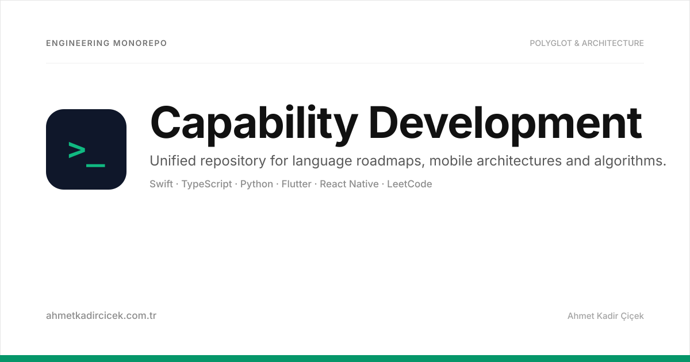

<div align="center">



# Capability Development 🚀

**A Unified Engineering Playbook · Polyglot Mastery · Mobile Frameworks · Algorithmic Excellence**

[](language-learn/swift/)
[](language-learn/javascript/)
[](language-learn/python/)
[](mobile-learn/flutter/)
[](mobile-learn/react-native/)
[](git-learn/)
[](leet-code-learn/)
[](LICENSE)

---

</div>

## 📖 Overview

**Capability Development** consolidates Ahmet Kadir Çiçek's technical roadmaps, language drills, mobile framework architectures, version control practices, and algorithmic problem-solving solutions into a single, cohesive repository.

Rather than maintaining fragmented learning repositories, this mono-repo structure provides a centralized knowledge hub for software craftsmanship, production best practices, and code examples.

---

## 🏛️ Directory Architecture

```
capability-development/
├── docs/                                  # Master vector banners & visual architecture assets
│   └── banner.svg
├── language-learn/                        # Polyglot language deep-dives
│   ├── swift/                             # Complete Swift 6 roadmap (00-13, capstones, toolbox)
│   ├── javascript/                        # ES6+, DOM manipulation, async JS, closures & test-cases
│   └── python/                            # Python 3 data structures, OOP & clean code
├── mobile-learn/                          # Cross-platform & native mobile architectures
│   ├── flutter/                           # IKEA Store Clone, OTP widget, state management
│   └── react-native/                      # Expo Router, Coursera specialization, responsive UI
├── git-learn/                             # Git CLI cheat-sheet, branching models, configuration
└── leet-code-learn/                       # 25+ LeetCode problem solutions in Python & JavaScript
```

---

## 🧭 Modules & Learning Paths

### 1. ⚡ [Language Learn](language-learn/)
Deep dives into modern, multi-paradigm programming languages:

| Submodule | Focus Area | Highlights |
|---|---|---|
| **[`swift/`](language-learn/swift/)** | Swift 6, SwiftUI & iOS Architecture | 14 phased modules from setup to Concurrency (`async/await`, `actor`), Combine, UIKit, MVVM-C, and Capstone projects. |
| **[`javascript/`](language-learn/javascript/)** | Modern JavaScript (ES6+) | Scope, closures, execution context, DOM tree manipulation, event bubbling, array prototypes, and unit drills. |
| **[`python/`](language-learn/python/)** | Python 3 Fundamentals | Core syntax, data structures (lists, tuples, dicts, sets), OOP patterns, and Pythonic idioms. |

### 2. 📱 [Mobile Learn](mobile-learn/)
Production-oriented UI patterns and mobile platform architectures:

| Submodule | Framework | Description |
|---|---|---|
| **[`flutter/`](mobile-learn/flutter/)** | Flutter & Dart | Full-fidelity **IKEA Store Clone** and reusable **OTP SMS verification** custom widget with responsive design. |
| **[`react-native/`](mobile-learn/react-native/)** | React Native & Expo | Meta Coursera mobile specialization modules featuring Expo Router, component trees, custom hooks, and navigation. |

### 3. 🌿 [Git Learn](git-learn/)
Professional source control handbook and terminal efficiency:

- **Branching Topologies**: Feature branch workflow, GitFlow, trunk-based development.
- **CLI Mastery**: Interactive rebase (`git rebase -i`), commit squashing, stash workflows, bisect, and selective cherry-picking.
- **Config & Shell**: Optimized global git configuration and command-line navigation.

### 4. 💡 [LeetCode Learn](leet-code-learn/)
Algorithmic challenges categorized with explicit time & space complexity analysis:

- **Two Pointers & Sliding Window**: Two Sum, 3Sum, Longest Substring Without Repeating Characters.
- **Dynamic Programming & Greedy**: Best Time to Buy and Sell Stock, Climbing Stairs.
- **Strings & Hash Tables**: Valid Anagram, Valid Palindrome, Longest Common Prefix, Valid Parentheses.
- **Lists & Math**: Merge Two Sorted Lists, Add Two Numbers, Sqrt(x), Grid-based Adjacency Matrix.

---

## 🛠️ Quickstart

Each directory contains its own dedicated dependencies, configuration files, and step-by-step guides:

```bash
# 1. Clone repository
git clone https://github.com/ahmetkadircicek/capability-development.git
cd capability-development

# 2. Explore Swift modules
cd language-learn/swift && open README.md

# 3. Run Flutter IKEA Clone
cd ../../mobile-learn/flutter/ikea_clone && flutter pub get && flutter run

# 4. Run React Native Expo app
cd ../../mobile-learn/react-native/coursera && npm install && npx expo start

# 5. Run LeetCode algorithmic drills
cd ../../../leet-code-learn && python3 two-sum.py
```

---

## 👨‍💻 Author

**Ahmet Kadir Çiçek**  
Mobile & Wearables Developer at **[Huawei Türkiye R&D Center](https://www.huawei.com/)**

- 🌐 Website: [ahmetkadircicek.com.tr](https://ahmetkadircicek.com.tr)
- 💼 LinkedIn: [in/akadircicek](https://www.linkedin.com/in/akadircicek)
- 🐙 GitHub: [@ahmetkadircicek](https://github.com/ahmetkadircicek)

---

<div align="center">
  <sub>Part of Ahmet Kadir Çiçek's Engineering Knowledge Base · Open Source</sub>
</div>
