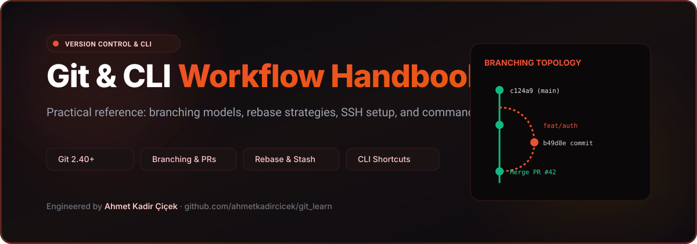

# Git & CLI Workflow Handbook

<div align="center">



### Practical Git and command-line cheat sheet, setup guides and branching workflow documentation.

[](https://git-scm.com/)
[](https://cli.github.com/)
[](https://www.gnu.org/software/bash/)
[](LICENSE)

</div>

---

## 📌 Overview

**Git Learn** is a field manual and reference workbook covering essential command-line techniques, version control conventions, branching strategies, and emergency recovery maneuvers for day-to-day software development.

Whether configuring SSH keys on a fresh macOS installation, rebasing complex feature branches, or cleaning up staging history, this repository provides verified, zero-fluff recipes.

---

## ⚡ Quick Reference: Daily Git Commands

### 1. Global Identity & Authentication
```bash
# Configure username and email
git config --global user.name "Ahmet Kadir Çiçek"
git config --global user.email "akadircicek@outlook.com"

# Check active configuration
git config --global --list
```

### 2. Daily Development Cycle
```bash
# Create and switch to a feature branch
git switch -c feat/user-auth

# Stage specific changes or everything
git add src/components/Login.tsx
# or: git add .

# Commit with conventional commit prefixes
git commit -m "feat(auth): integrate biometric face id verification"

# Push and track upstream
git push -u origin feat/user-auth
```

### 3. Branching & Rebase Hygiene
```bash
# Fetch latest remote changes without merge commit
git fetch origin

# Rebase local feature branch onto latest main
git switch feat/user-auth
git rebase origin/main

# Resolve any merge conflicts, then continue
git add .
git rebase --continue
```

### 4. Emergency Undos & Stashing
| Situation | Command | Description |
|---|---|---|
| Need to switch branches with dirty working tree | `git stash push -m "wip"` | Temporarily shelves changes |
| Bring shelved changes back | `git stash pop` | Restores last stashed modifications |
| Discard unstaged changes to a single file | `git restore <file>` | Reverts file to last committed state |
| Unstage a file without losing modifications | `git restore --staged <file>` | Removes from index back to working dir |
| Amend previous commit message / add missed file | `git commit --amend` | Overwrites head commit |

---

## 🏛️ Directory Structure

```
git-learn/
├── installation_setup/
│   ├── configure_git.txt          # Git global configuration commands
│   └── learning_command_line.txt  # Shell navigation, flags & piping fundamentals
├── docs/                          # Architecture diagrams & vector graphics
└── README.md                      # Comprehensive reference guide
```

---

## 👨‍💻 Author

**Ahmet Kadir Çiçek**
- Website: [ahmetkadircicek.com.tr](https://ahmetkadircicek.com.tr)
- GitHub: [@ahmetkadircicek](https://github.com/ahmetkadircicek)
- LinkedIn: [in/akadircicek](https://www.linkedin.com/in/akadircicek)

---

## 📄 License

This repository is licensed under the [MIT License](LICENSE).
