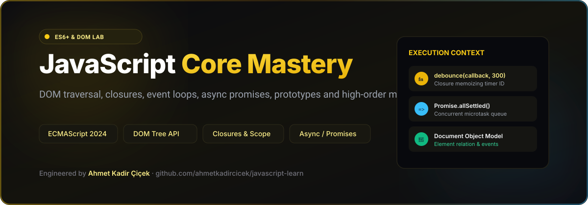
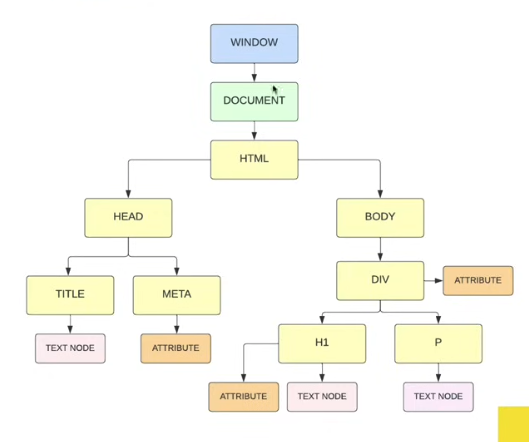
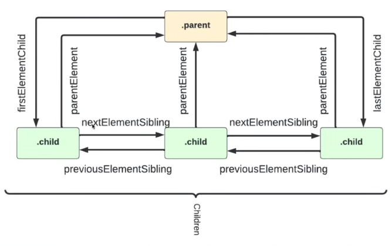
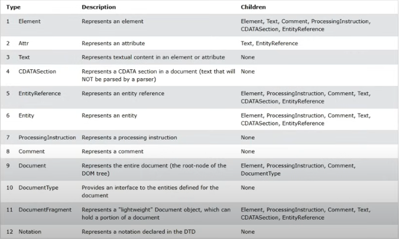

# JavaScript Core Mastery — ES6+ & DOM Lab

<div align="center">



### Comprehensive modern JavaScript reference and practice lab covering DOM manipulation, closures, async/promises, prototypes and algorithms.

[](https://developer.mozilla.org/en-US/docs/Web/JavaScript)
[](https://developer.mozilla.org/en-US/docs/Web/API/Document_Object_Model)
[](https://developer.mozilla.org/en-US/docs/Web/JavaScript/Reference/Global_Objects/Promise)
[](LICENSE)

<br/>

<p align="center">
  
  &nbsp;&nbsp;
  
  &nbsp;&nbsp;
  
</p>

</div>

---

## 📖 Overview

**JavaScript Learn** is an organized developer lab covering the foundational mechanics of JavaScript (ECMAScript 2024+) and browser APIs. It provides practical exercises, interactive browser tests, and unit verification for core language topics: execution contexts, memory references, closure patterns, prototype inheritance, event propagation, and asynchronous concurrency.

---

## 📚 Curriculum & Topic Modules

| Module | Core Topics Covered | Practical Exercises |
|---|---|---|
| **[Variables & Data Types](variables-and-data-types/)** | Primitive vs reference types, type coercion, string methods, template literals, Math & Date APIs | Arrays, numbers, strings |
| **[Arrays & Objects](arrays-and-objects/)** | Spread syntax `...`, destructuring assignment, nested objects, JSON serialization, shallow vs deep cloning | Object manipulation, JSON drills |
| **[Functions & Execution Context](functions-scope-and-execution-context/)** | Call stack, global vs function scope, block scope (`let`/`const`), hoisting, IIFE, arrow functions | Scope chains, context inspection |
| **[Logic & Control Flow](logic-and-control-flow/)** | Truthy & falsy values, ternary expressions, logical operators with short-circuiting, switch statements | Conditional workflows |
| **[Loops & Higher-Order Methods](loops-and-high-order-array-methods/)** | `map()`, `filter()`, `reduce()`, `forEach()`, `find()`, `some()`, `every()`, for-of and for-in iteration | Array aggregation algorithms |
| **[The Document Object Model (DOM)](the-document-object-model/)** | DOM tree traversal (`parentNode`, `children`, `nextElementSibling`), element creation, innerHTML vs textContent, classList manipulation | Interactive DOM manipulation |
| **[Events & Inputs](event-and-inputs/)** | Event bubbling and capturing, `addEventListener`, delegation, form input handling, keyboard and mouse events | Form inputs, event delegation |
| **[Advanced Test Cases](test-cases/)** | Closures, debounce/throttle algorithms, hoisting edge-cases, Promise concurrency, prototype chain inheritance | Unit verification scripts |

---

## ⚡ Code Drill: Debounce Implementation

```javascript
/**
 * Creates a debounced function that delays invoking callback until
 * after wait milliseconds have elapsed since the last invocation.
 */
function debounce(callback, delay = 300) {
  let timerId;
  return function (...args) {
    clearTimeout(timerId);
    timerId = setTimeout(() => {
      callback.apply(this, args);
    }, delay);
  };
}

// Example usage on window resize or search input:
const handleSearch = debounce((query) => {
  console.log(`Executing search for: ${query}`);
}, 250);
```

---

## 🚀 Running the Drills

Each module contains an `index.html` and a companion `script.js` that can be run directly in any web browser without build tools or external dependencies:

```bash
# 1. Clone repository
git clone https://github.com/ahmetkadircicek/javascript-learn.git
cd javascript-learn

# 2. Open any exercise directly in your browser:
open the-document-object-model/traversing-the-dom/index.html
# OR run a standalone script with Node.js:
node what-is-javascript.js
```

---

## 👨‍💻 Author

**Ahmet Kadir Çiçek**
- Website: [ahmetkadircicek.com.tr](https://ahmetkadircicek.com.tr)
- GitHub: [@ahmetkadircicek](https://github.com/ahmetkadircicek)
- LinkedIn: [in/akadircicek](https://www.linkedin.com/in/akadircicek)

---

## 📄 License

This repository is licensed under the [MIT License](LICENSE).
