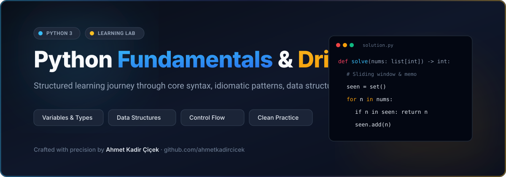

# Python Fundamentals & Drills



[](https://www.python.org/)
[](LICENSE)
[](https://peps.python.org/pep-0008/)
[](https://ahmetkadircicek.com.tr)

A structured, hands-on repository covering core Python programming from the ground up: syntax fundamentals, idiomatic patterns, memory model, data structures, and algorithmic drills.

Designed as an ongoing developer reference and practice playground for writing clean, performant, and type-annotated modern Python.

---

## 📚 Curriculum & Topic Matrix

### 1. Variables & Primitive Types
| Topic | Concepts Covered | Status | Notes & Source |
|---|---|---|---|
| **Integers & Floats** | Arbitrary precision integers, IEEE 754 float precision, arithmetic operators, floor division, modulo | Completed | [`variables_and_data_types.py`](variables_and_data_types.py) |
| **Strings (`str`)** | Immutability, f-strings, slicing syntax `[start:stop:step]`, escape characters, common methods | Completed | [`variables_and_data_types.py`](variables_and_data_types.py) |
| **Booleans (`bool`)** | Truthy vs Falsy values, logical short-circuiting (`and`, `or`, `not`), boolean identity | Completed | [`variables_and_data_types.py`](variables_and_data_types.py) |

### 2. Built-in Collections & Data Structures
| Topic | Characteristics | Mutability | Lookup Time |
|---|---|---|---|
| **Lists (`list`)** | Dynamic array, ordered, indexed | Mutable | $O(1)$ index, $O(n)$ search |
| **Tuples (`tuple`)** | Fixed sequence, hashable when items are immutable | Immutable | $O(1)$ index, $O(n)$ search |
| **Dictionaries (`dict`)** | Hash map, key-value mappings, insertion-ordered (Python 3.7+) | Mutable | $O(1)$ average get/set |
| **Sets (`set`)** | Hash set, unique elements, set operations (union, intersection, diff) | Mutable | $O(1)$ average membership |

### 3. Control Flow & Idiomatic Patterns
- **Conditionals**: `if / elif / else` branching, ternary expressions (`x if cond else y`).
- **Loops**: `for ... in` iteration with `enumerate()` and `zip()`, `while` loops with safety guards.
- **Comprehensions**: List, dictionary, and set comprehensions for concise and readable transformations.

---

## ⚡ Code Sample: Idiomatic Python

```python
from typing import Dict, List, Optional

def analyze_scores(records: List[Dict[str, int]], threshold: int = 70) -> Dict[str, float]:
    """
    Computes passing rates and average metrics across student batches.
    Demonstrates list comprehensions, dict manipulations and type hints.
    """
    passing_scores = [rec['score'] for rec in records if rec.get('score', 0) >= threshold]
    if not passing_scores:
        return {'average': 0.0, 'pass_rate': 0.0}
    
    return {
        'average': round(sum(passing_scores) / len(passing_scores), 2),
        'pass_rate': round(len(passing_scores) / len(records) * 100, 1),
    }

if __name__ == '__main__':
    data = [{'student': 'Ali', 'score': 85}, {'student': 'Veli', 'score': 62}]
    print(analyze_scores(data))
```

---

## 🚀 Running the Code Locally

No external dependencies are required. All examples run on standard library Python 3.8+:

```bash
# Clone the repository
git clone https://github.com/ahmetkadircicek/python-learn.git
cd python-learn

# Run any module directly
python3 variables_and_data_types.py
```

---

## 👨‍💻 Author

**Ahmet Kadir Çiçek**
- Website: [ahmetkadircicek.com.tr](https://ahmetkadircicek.com.tr)
- GitHub: [@ahmetkadircicek](https://github.com/ahmetkadircicek)
- LinkedIn: [in/akadircicek](https://www.linkedin.com/in/akadircicek)

---

## 📄 License

This repository is licensed under the [MIT License](LICENSE).
