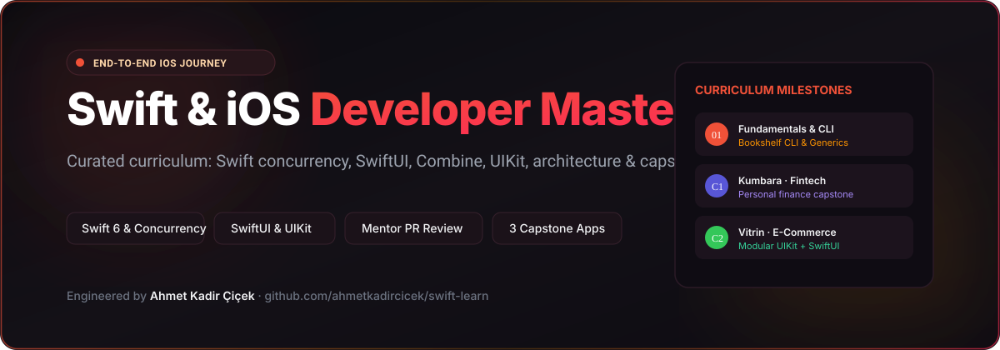

# Swift & iOS Developer Mastery

### End-to-end iOS developer journey: drills, builds and capstones with a mentor-reviewed PR workflow.

---

## 🎯 Vizyon ve Çalışma Düzeni

Bu repo, profesyonel bir **öğrenme ve mentorluk laboratuvarıdır**. Gerçek bir yüksek standartlı iOS mühendislik ortamını taklit eder:
- 🛡️ Korumalı `main` dalı
- 📋 Her kavram ve görev için ayrı GitHub Issue
- 🌿 `drill/<id>-<konu>` çalışma branch'leri
- 🔍 Detaylı kod incelemesi (Code Review)
- 🔀 Squash & Merge entegrasyonu

> 🚀 **Başlangıç:** 12 Ekim 2026 · **Kapasite:** ~6 saat/hafta · 🚪 **Hedef Başvuru Kapısı:** 27 Ağustos 2027

---

## 📐 Nasıl Çalışıyor?

| Katman | Tanım | Kapsam & Çıktı | Süre |
|---|---|---|---|
| 🎯 **Drill** | Tek bir konuya odaklı mikro alıştırma | Kavram analizi, örnek snippet'ler, özel çözümler | 0.5 – 2 saat |
| 🧱 **Build** | Modül bitirme mini uygulaması | "PM'den gelen ticket" formatında uçtan uca çalışan mini app | 5 – 12 saat |
| 🏆 **Capstone** | Portfolyoya eklenecek tam teşekküllü ürün | Ayrı repoda geliştirilen, testleri yazılmış prodüksiyon app | 30 – 40 saat |

Ayrıntılı süreç akışı: [`docs/workflow.md`](docs/workflow.md)

---

## 🗺️ Modüler Yol Haritası

Durum: ⬜ Planlandı · 🟦 Devam Ediyor · ✅ Tamamlandı

| # | Modül | Pratik / Build / Capstone | Süre | Hedef Tarih | Durum |
|---|---|---|---|---|---|
| **00** | [Setup](00-setup/) | Xcode 16 tour, simulator configs, CLI | 8h | 23 Eki 2026 | 🟦 |
| **01** | [Swift Fundamentals](01-swift-fundamentals/) | **Bookshelf CLI** (Generics, protocols, enums) | 20h | 20 Kas 2026 | ⬜ |
| **02** | [Swift Concurrency](02-swift-concurrency/) | **Concurrent Downloader CLI** (Async/await, actors) | 15h | 11 Ara 2026 | ⬜ |
| **03** | [SwiftUI](03-swiftui/) | **Habitly** (State, bindings, custom modifiers) | 20h | 15 Oca 2027 | ⬜ |
| **04** | [Networking](04-networking/) | **Pokedex** (URLSession, Decodable, caching) | 16h | 12 Şub 2027 | ⬜ |
| **05** | [Persistence](05-persistence/) | SwiftData schema & CloudKit integration | 10h | 26 Şub 2027 | ⬜ |
| **C1** | [**Kumbara** · Fintech](capstones/01-kumbara/) | 🏆 **Capstone 1: Kişisel Finans ve Bütçe** | 30h | 9 Nis 2027 | ⬜ |
| **06** | [Combine](06-combine/) | Publishers, subscribers, backpressure | 5h | 9 Nis 2027 | ⬜ |
| **07** | [UIKit](07-uikit/) | **HNReader** (AutoLayout, programmatic UI, coordinator) | 24h | 28 May 2027 | ⬜ |
| **08** | [Architecture](08-architecture/) | MVVM, Clean Architecture, Dependency Injection | 8h | 4 Haz 2027 | ⬜ |
| **C2** | [**Vitrin** · E-Ticaret](capstones/02-vitrin/) | 🏆 **Capstone 2: Modüler E-Ticaret Platformu** | 40.5h | 13 Ağu 2027 | ⬜ |
| **09** | [Testing](09-testing/) | Swift Testing, XCTest, Mocking, C1 test paketi | 12.5h | 20 Ağu 2027 | ⬜ |
| 🚪 | **Kariyer & Başvuru Kapısı** | CV, Portfolyo, App Store canlı sürümleri | 8h | **27 Ağu 2027** | ⬜ |
| **10** | [Platform Features](10-platform-features/) | Widgets, Live Activities, App Intents | 14h | 24 Eyl 2027 | ⬜ |
| **11** | [Ecosystem](11-ecosystem/) | SPM, CocoaPods, fastlane CI/CD | 7h | 5 Kas 2027 | ⬜ |
| **12** | [Shipping](12-shipping/) | TestFlight, App Store Connect, signing | 8.5h | 26 Kas 2027 | ⬜ |
| **C3** | [**Pulse** · Sağlık](capstones/03-pulse/) | 🏆 **Capstone 3: Apple HealthKit Fitness Takibi** | 34.5h | 3 Ara 2027 | ⬜ |

---

## 🏆 Capstone Projeleri

- 🐷 **[Kumbara](capstones/01-kumbara/)** (Fintech / Kişisel Finans): Bankacılık seviyesi veri güvenliği, SwiftData ve grafik analizleri.
- 🛍️ **[Vitrin](capstones/02-vitrin/)** (E-Ticaret): Trendyol / Hepsiburada tarzı büyük modüler mimari; Programmatic UIKit + SwiftUI hibrit yapısı.
- 💓 **[Pulse](capstones/03-pulse/)** (Sağlık & Fitness): Huawei Health Kit uzmanlığımın iOS Apple HealthKit karşılığı.

---

## 🧰 Geliştirici Alet Çantası ([toolbox/](toolbox/))

- [Xcode Kısayolları](toolbox/xcode-shortcuts.md) • [Xcode Ayarları](toolbox/xcode-settings.md) • [Swift Snippet'leri](toolbox/snippets.md)
- [Flutter → iOS Geçiş Sözlüğü](toolbox/flutter-to-ios.md) • [Paket Ekosistemi](toolbox/packages.md) • [Debugging Rehberi](toolbox/debugging.md)

---

## 👨‍💻 Geliştirici

**Ahmet Kadir Çiçek**
- Website: [ahmetkadircicek.com.tr](https://ahmetkadircicek.com.tr)
- GitHub: [@ahmetkadircicek](https://github.com/ahmetkadircicek)
- LinkedIn: [in/akadircicek](https://www.linkedin.com/in/akadircicek)

---

## 📄 Lisans

Bu repo eğitim, dokümantasyon ve portfolyo amaçlı hazırlanmıştır © Ahmet Kadir Çiçek.
