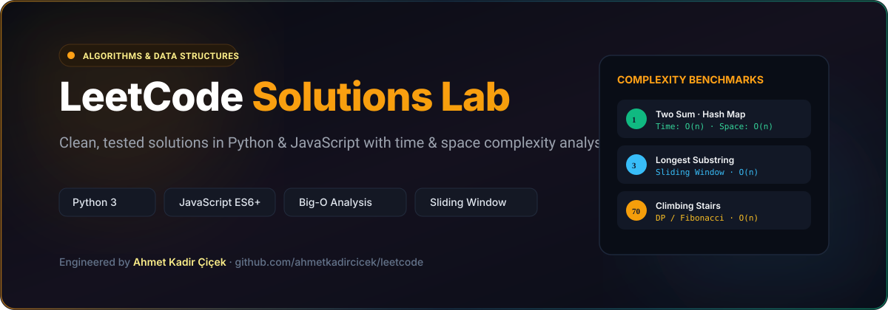

# LeetCode Solutions Lab

<div align="center">



### Clean, tested solutions to LeetCode algorithm and data structure problems in Python and JavaScript.

[](https://www.python.org/)
[](https://developer.mozilla.org/)
[](https://leetcode.com/)
[](LICENSE)

</div>

---

## 🎯 Overview

This repository contains clean, readable, and space/time-optimized solutions to classic algorithm and data structure problems from [LeetCode](https://leetcode.com). 

Every solution is written with clean code practices, descriptive variable naming, and documented time ($O$) and space ($O$) complexity bounds.

---

## 📊 Problem Solutions Index

### 1. Arrays & Hashing
| # | Problem | Language | Solution File | Time Complexity | Space Complexity |
|---|---|---|---|---|---|
| 1 | Two Sum | Python | [`two-sum.py`](two-sum.py) | $O(n)$ | $O(n)$ |
| 217 | Valid Anagram | JavaScript | [`valid-anagram.js`](valid-anagram.js) | $O(n)$ | $O(1)$ |
| 121 | Best Time to Buy and Sell Stock | JavaScript | [`best-time-to-buy-and-sell-stock.js`](best-time-to-buy-and-sell-stock.js) | $O(n)$ | $O(1)$ |
| 283 | Move Zeroes | JavaScript | [`move-zeroes.js`](move-zeroes.js) | $O(n)$ | $O(1)$ |
| 26 | Remove Duplicates from Sorted Array | Python | [`remove_duplicates_from_sorted_array.py`](remove_duplicates_from_sorted_array.py) | $O(n)$ | $O(1)$ |
| 27 | Remove Element | Python | [`remove_element.py`](remove_element.py) | $O(n)$ | $O(1)$ |
| 2154 | Keep Multiplying Found Values by Two | JavaScript | [`keep-multiplying-found-values-by-two.js`](keep-multiplying-found-values-by-two.js) | $O(n)$ | $O(1)$ |

### 2. Strings & Two Pointers
| # | Problem | Language | Solution File | Time Complexity | Space Complexity |
|---|---|---|---|---|---|
| 3 | Longest Substring Without Repeating Characters | Python | [`longest-substring-without-repeating-characters.py`](longest-substring-without-repeating-characters.py) | $O(n)$ | $O(k)$ |
| 14 | Longest Common Prefix | Python | [`longest-common-prefix.py`](longest-common-prefix.py) | $O(S)$ | $O(1)$ |
| 125 | Valid Palindrome | JavaScript | [`valid-palindrome.js`](valid-palindrome.js) | $O(n)$ | $O(1)$ |
| 28 | Find Index of First Occurrence in String | Python | [`find_the_index_of_the_first_occurrence_in_a_string.py`](find_the_index_of_the_first_occurrence_in_a_string.py) | $O(n)$ | $O(1)$ |
| 58 | Length of Last Word | Python | [`length-of-last-word.py`](length-of-last-word.py) | $O(n)$ | $O(1)$ |

### 3. Stack & Linked List
| # | Problem | Language | Solution File | Time Complexity | Space Complexity |
|---|---|---|---|---|---|
| 20 | Valid Parentheses | Python | [`valid-parentheses.py`](valid-parentheses.py) | $O(n)$ | $O(n)$ |
| 2 | Add Two Numbers | Python | [`add-two-sum.py`](add-two-sum.py) | $O(\max(m, n))$ | $O(\max(m, n))$ |
| 21 | Merge Two Sorted Lists | Python | [`merge_two_sorted_lists.py`](merge_two_sorted_lists.py) | $O(n + m)$ | $O(1)$ |

### 4. Dynamic Programming & Math
| # | Problem | Language | Solution File | Time Complexity | Space Complexity |
|---|---|---|---|---|---|
| 70 | Climbing Stairs | Python | [`climbing-stairs.py`](climbing-stairs.py) | $O(n)$ | $O(1)$ |
| 35 | Search Insert Position | Python | [`search-insert-position.py`](search-insert-position.py) | $O(\log n)$ | $O(1)$ |
| 67 | Add Binary | Python | [`add-binary.py`](add-binary.py) | $O(\max(a, b))$ | $O(\max(a, b))$ |
| 9 | Palindrome Number | Python | [`palindrome-number.py`](palindrome-number.py) | $O(\log_{10} n)$ | $O(1)$ |
| 66 | Plus One | Python | [`plus-one.py`](plus-one.py) | $O(n)$ | $O(1)$ |
| 69 | Sqrt(x) | Python | [`sqrtx.py`](sqrtx.py) | $O(\log n)$ | $O(1)$ |
| — | Grid-Based Adjacency Matrix | Python | [`grid-based-adjacency-matrix.py`](grid-based-adjacency-matrix.py) | $O(V^2)$ | $O(V^2)$ |

---

## ⚡ Solution Spotlight: Longest Substring Without Repeating Characters

```python
class Solution:
    def lengthOfLongestSubstring(self, s: str) -> int:
        """
        Sliding window technique using a dictionary to track last seen indices.
        Time: O(n) where n is len(s). Space: O(min(m, n)) for unique characters.
        """
        char_index = {}
        max_length = 0
        left = 0
        
        for right, char in enumerate(s):
            if char in char_index and char_index[char] >= left:
                left = char_index[char] + 1
            char_index[char] = right
            max_length = max(max_length, right - left + 1)
            
        return max_length
```

---

## 🚀 Running the Solutions

```bash
# Clone the repository
git clone https://github.com/ahmetkadircicek/leetcode.git
cd leetcode

# Run any Python solution
python3 two-sum.py

# Run any JavaScript solution
node valid-anagram.js
```

---

## 👨‍💻 Author

**Ahmet Kadir Çiçek**
- Website: [ahmetkadircicek.com.tr](https://ahmetkadircicek.com.tr)
- GitHub: [@ahmetkadircicek](https://github.com/ahmetkadircicek)
- LinkedIn: [in/akadircicek](https://www.linkedin.com/in/akadircicek)

---

## 📄 License

This repository is licensed under the [MIT License](LICENSE).
