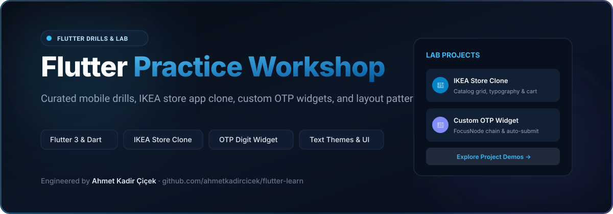
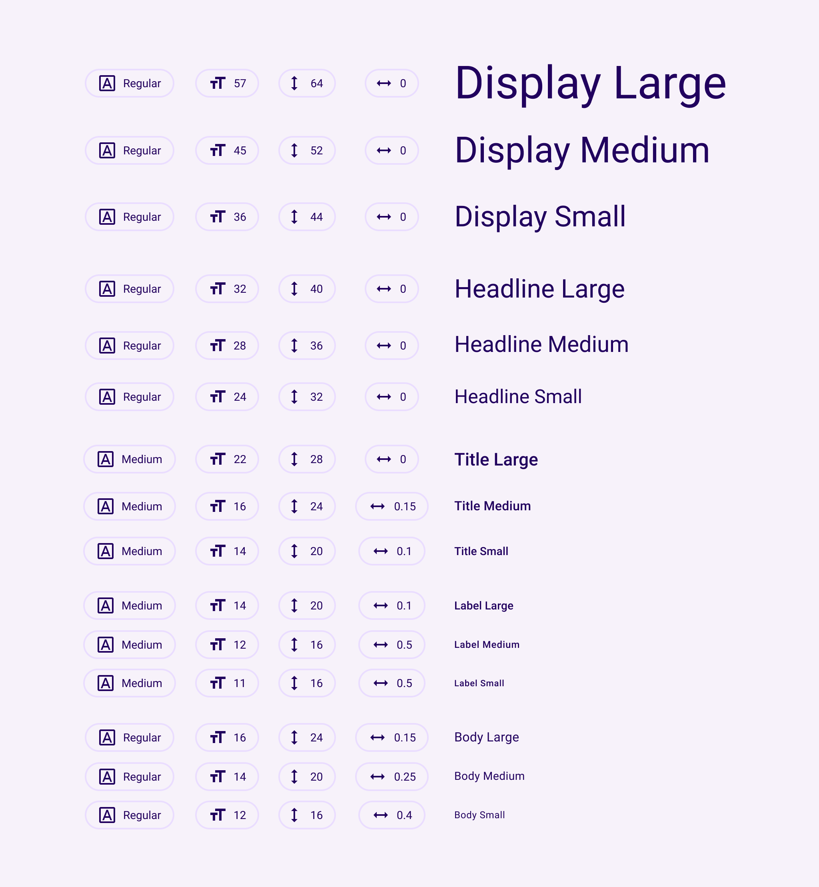

# Flutter Learn — Practice Lab & Component Drills

<div align="center">



### Curated collection of Flutter practice projects, including an IKEA shopping app clone and custom OTP verification widgets.

[](https://flutter.dev)
[](https://dart.dev)
[](https://flutter.dev)
[](LICENSE)

<br/>

<p align="center">
  
</p>

</div>

---

## 📱 Overview

**Flutter Learn** houses focused drills, UI clones, and reusable atomic mobile widgets built with Flutter and Dart. It documents architectural experiments around state management, responsive text styling, form input focus chains, and retail mobile shopping patterns.

---

## 📦 Projects & Modules Included

### 1. [IKEA Store Clone](ikea_clone/)
A full mobile e-commerce interface replicating the retail shopping experience of IKEA:
- **Typography & Theme Hierarchy**: Custom design tokens mirroring IKEA's Scandinavian minimalist design language (`Text Theme.png`).
- **Product Catalog Grid**: Smooth scrolling staggered grid of furniture items, price tags, and stock availability pills.
- **Cart & Bag Flow**: Digital shopping bag with quantity selectors and checkout calculation.
- **Cross-Platform Compilation**: Supports Android, iOS, Web, macOS, Linux, and Windows.

```bash
cd ikea_clone
flutter pub get
flutter run
```

### 2. [OTP Verification Widget](otp_widget/)
A standalone input component for SMS and two-factor authentication PIN verification:
- **FocusNode Automation**: Automatic focus advancement to the next digit field on keypress, and backspace handling to previous digits.
- **Custom Borders & Active States**: Distinct visual feedback for active, filled, and error states.
- **Auto-Submit Hook**: Callback triggered when all digits are completed.

```bash
cd otp_widget
flutter pub get
flutter run
```

---

## 🏛️ Directory Layout

```
flutter-learn/
├── ikea_clone/           # IKEA retail shopping application clone
│   ├── lib/              # App entry, screens, product models, theme tokens
│   └── Text Theme.png    # Typography design token specification
├── otp_widget/           # Standalone multi-digit OTP pin input widget
│   └── lib/              # OTP input controller and digit fields
└── docs/                 # Documentation assets and vector banners
```

---

## 🚀 Running the Projects

Each project folder is completely independent and self-contained with its own `pubspec.yaml`:

```bash
# Clone repository
git clone https://github.com/ahmetkadircicek/flutter-learn.git
cd flutter-learn

# Choose a project to run
cd ikea_clone # or cd otp_widget
flutter pub get
flutter run
```

---

## 👨‍💻 Author

**Ahmet Kadir Çiçek**
- Website: [ahmetkadircicek.com.tr](https://ahmetkadircicek.com.tr)
- GitHub: [@ahmetkadircicek](https://github.com/ahmetkadircicek)
- LinkedIn: [in/akadircicek](https://www.linkedin.com/in/akadircicek)

---

## 📄 License

This repository is licensed under the [MIT License](LICENSE).
