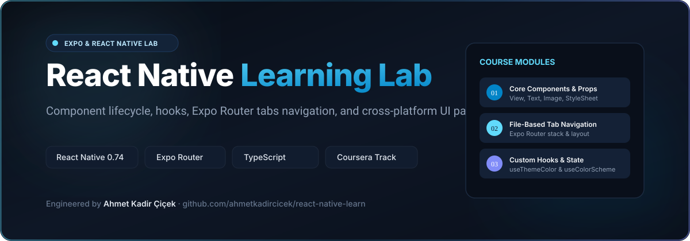

# React Native Learn — Expo & Cross-Platform Lab

<div align="center">



### React Native & Expo learning repository covering component lifecycle, hooks, tabs navigation and cross-platform mobile patterns.

[](https://reactnative.dev)
[](https://expo.dev)
[](https://www.typescriptlang.org)
[](https://docs.expo.dev/router/introduction/)
[](LICENSE)

<br/>

<p align="center">
  
</p>

</div>

---

## 📱 Overview

**React Native Learn** is an organized developer workbook documenting cross-platform mobile development with React Native, TypeScript, and Expo. It contains practical projects completed through the **Meta / Coursera React Native Specialization**, exploring declarative layouts with Flexbox, component lifecycle management, file-based routing with Expo Router, and performance optimization for iOS and Android.

---

## 📚 Curriculum & Module Breakdown

### 1. [Coursera Core Module](coursera/)
- **File-Based Routing**: Dynamic navigation hierarchies structured with Expo Router (`app/_layout.tsx`, `app/(tabs)/index.tsx`, `app/(tabs)/explore.tsx`).
- **Core Components & Layout**: In-depth usage of `View`, `Text`, `Image`, `FlatList`, `ScrollView`, and `StyleSheet.create`.
- **Custom Hooks**: Implementation of `useThemeColor` and `useColorScheme` for responsive light/dark adaptive palettes.
- **Themed Design Tokens**: Centralized typography and color values in `constants/Colors.ts`.
- **Platform Parity**: Uniform rendering and testing across Web, iOS Simulator, and Android Emulator.

---

## 🏛️ Directory Layout

```
react-native-learn/
├── coursera/             # Coursera React Native coursework project
│   ├── app/              # Expo Router tabs and modal screens
│   ├── components/       # Collapsible, ParallaxScrollView, ThemedView, ThemedText
│   ├── constants/        # App colors and styling tokens
│   ├── hooks/            # Custom React hooks (useThemeColor, useColorScheme)
│   └── package.json      # Dependencies and Expo CLI scripts
└── docs/                 # Documentation assets and vector banners
```

---

## 🚀 Running the Project

```bash
# 1. Clone repository
git clone https://github.com/ahmetkadircicek/react-native-learn.git
cd react-native-learn/coursera

# 2. Install dependencies
npm install

# 3. Start Expo development server
npx expo start

# 4. Open in iOS Simulator (press 'i'), Android Emulator (press 'a'), or Web (press 'w')
```

---

## 👨‍💻 Author

**Ahmet Kadir Çiçek**
- Website: [ahmetkadircicek.com.tr](https://ahmetkadircicek.com.tr)
- GitHub: [@ahmetkadircicek](https://github.com/ahmetkadircicek)
- LinkedIn: [in/akadircicek](https://www.linkedin.com/in/akadircicek)

---

## 📄 License

This repository is licensed under the [MIT License](LICENSE).
